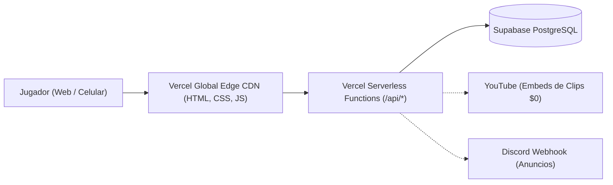

# GUÍA DE DESPLIEGUE A PRODUCCIÓN // CLIPBUNKER (VERCEL + SUPABASE)

Este documento detalla los pasos sencillos para desplegar el portal **CLIPBUNKER** en producción a costo $0 utilizando **Vercel** para el frontend/API y **Supabase** para la base de datos PostgreSQL en tiempo real.

---

## PASO 1: Crear la Base de Datos en Supabase (2 minutos)

1. Ingresa a [https://supabase.com](https://supabase.com) e inicia sesión (con GitHub o Google).
2. Haz clic en **"New Project"** (Nuevo Proyecto).
   - **Name**: `clipbunker` (o el que prefieras).
   - **Database Password**: Genera o escribe una contraseña segura.
   - **Region**: Elige la más cercana (ej: `South America (São Paulo)` o `US East`).
3. Una vez creado el proyecto, ve al menú lateral izquierdo y haz clic en **"SQL Editor"**.
4. Haz clic en **"New Query"**, copia y pega todo el contenido del archivo [`supabase_schema.sql`](./supabase_schema.sql) y pulsa **"Run"** (o presiona `Ctrl+Enter`).
5. ¡Listo! Se habrán creado las tablas con sus índices, políticas de seguridad RLS y datos iniciales de prueba (Foy, Stalingrad, Omaha, Carentan).

---

## PASO 2: Obtener las Credenciales de Supabase

1. En el panel de tu proyecto de Supabase, ve a **Project Settings** (icono de engranaje) -> **API**.
2. Copia los siguientes valores:
   - **Project URL** (ejemplo: `https://xyzcompany.supabase.co`) -> Será `SUPABASE_URL`.
   - **anon / public key** -> Será `SUPABASE_ANON_KEY`.
   - **service_role key** (revela el secreto) -> Será `SUPABASE_SERVICE_ROLE_KEY`.

---

## PASO 3: Desplegar en Vercel (1 minuto)

### Opción A: Desde la Web de Vercel (Recomendada con GitHub)
1. Sube tu carpeta del proyecto a un repositorio en **GitHub**.
2. Ve a [https://vercel.com](https://vercel.com) y haz clic en **"Add New..."** -> **"Project"**.
3. Importa tu repositorio de GitHub.
4. En la sección **"Environment Variables"** (Variables de Entorno), añade:
   - `SUPABASE_URL`: Tu Project URL de Supabase.
   - `SUPABASE_ANON_KEY`: Tu Anon Key de Supabase.
   - `SUPABASE_SERVICE_ROLE_KEY`: Tu Service Role Key de Supabase.
   - `MODERATOR_KEY`: Tu clave de moderador (por defecto: `HLL-MOD-1944`).
5. Haz clic en **"Deploy"**.

### Opción B: Con Vercel CLI (desde tu terminal)
```bash
npm install -g vercel
vercel
```
Sigue los pasos y agrega las variables de entorno en el panel de Vercel.

---

## PASO 4: Autenticación con Discord (Opcional / Integración Directa)

En Supabase puedes activar el login directo de Discord:
1. En Supabase ve a **Authentication** -> **Providers** -> **Discord**.
2. Activa la casilla **"Enable Discord"**.
3. Coloca tu `Client ID` y `Client Secret` del Discord Developer Portal.
4. Copia el **Callback URL** que te da Supabase y pégalo en los Redirects de tu aplicación de Discord.

---

## Arquitectura de Producción



- **Frontend estático**: Servido a nivel mundial con caché instantánea por la red Edge de Vercel.
- **Rutas API**: Funciones Serverless de ejecución ultra-rápida en Node.js conectadas a Supabase.
- **Base de Datos**: PostgreSQL en Supabase con persistencia real, escalabilidad automática y costo $0.
